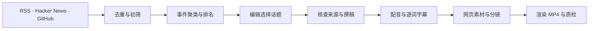

# 每日趋势 · Trend Radar

把一周的信息流，整理成今天值得追的选题。Trend Radar 是一个本地运行的中文视频编辑工作台。你可以从一个选题追到原始报道，修改口播和分镜，再导出带普通话配音和逐词字幕的竖屏视频。



## 快速开始

推荐环境为 macOS、Python 3.13、uv 和 Node.js。先试抓取和看板，有数据后再运行模型筛选。

```bash
git clone https://github.com/Atreides-coder/trend-radar.git
cd trend-radar
uv venv .venv --python 3.13
uv pip install --python .venv/bin/python -r requirements.txt
cp .env.example .env
.venv/bin/python scripts/init_db.py
.venv/bin/python -m src.main --stage fetch
./scripts/start_dashboard.sh
```

打开 [本地工作台](http://127.0.0.1:8765)。第一次抓取后，打开 **Raw Intelligence** 查看原始条目。**Events** 会在筛选与聚类完成后展示榜单。

### 从信息流到选题榜

安装当前版 Codex CLI 并登录。模型和推理强度在本地 `.env` 设置，示例使用 `gpt-6.2-astra` 和 `high`。使用你账号可以调用的模型。

```bash
npm install -g @openai/codex
codex login
.venv/bin/python -m src.main --stage filter
.venv/bin/python -m src.main --stage cluster
```

点开一个事件可以查看聚合了哪些报道、来自几个独立来源，以及它为何进入研究队列。来源清单在 `config/sources.yaml`，筛选规则在 `config/prefilter.yaml`，排名权重在 `config/settings.yaml`。

### 从选题到成片

视频制作还需要 FFmpeg、ffprobe、Google Chrome、Swift 和网络连接。安装视频依赖后，在 **Events** 选定话题并点 **Create Video**。在 **Video Studio** 可查看事实出处、改稿、换镜头和重渲染。默认产出为 1080 × 1920、30 fps 的 MP4，目标时长 45–60 秒。

```bash
npm ci --prefix video
```

模型负责研究、撰稿和规划镜头。Edge TTS 在线合成普通话并返回词级时间，Remotion 和 FFmpeg 在本机渲染。原始数据、编辑反馈和成片分别保存在本机 SQLite 与项目目录中。使用模型时，相关来源、提示词和所选素材的文字会发送给模型服务。系统设置窗口截图默认关闭。

## 一个实际剪辑例子

一则心脏科医生招募启事写着「最高每小时 180 美元」。剪辑先推近原网页的报价，再随口播圈出 **Up to**；中段翻到培训费率的脚注，结尾回到月收入计算还缺的付费工时。这个版本使用单独编排的镜头，并复用了工作台生成的配音时间轴。[查看分镜源码与复用说明](video/examples/source-edit/README.md)

## 仓库导航

| 目录 | 内容 |
| --- | --- |
| `src/fetchers/`、`src/pipeline/` | 来源采集、规则筛选、模型评分与事件聚类 |
| `prompts/`、`config/` | 编辑判断提示词、数据源、权重与视频配置 |
| `dashboard/`、`src/dashboard/` | React 工作台与本地 FastAPI 接口 |
| `src/video/`、`video/` | 研究、素材、配音、Remotion 模板、渲染和质检 |
| `tests/` | 音频同步、社区研究和视频导入的回归测试 |

可选集成包括 last30days 的近期讨论检索，以及 AutoClip 的本地镜头拆分。安装方式、运行阶段和数据库字段见[工作流手册](docs/workflow.md)。

```bash
.venv/bin/python -m unittest discover -s tests
```

## 许可

项目自有代码使用 [MIT 许可证](LICENSE)。第三方工具、字体、网页、新闻图片和录屏各自保有原有权利。Remotion 的使用条件见 [Remotion License](https://www.remotion.dev/license)。公开示例提供镜头代码，使用者可自行提供已获授权的素材。
